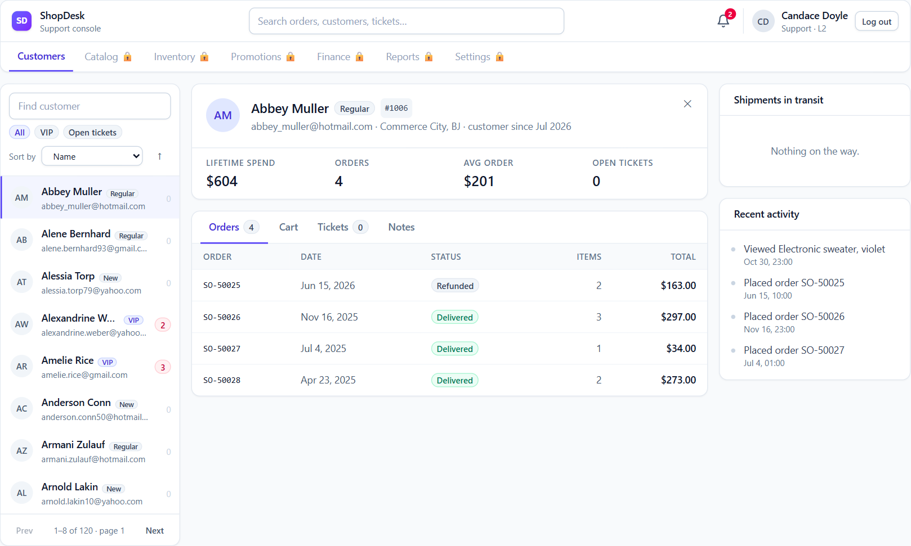
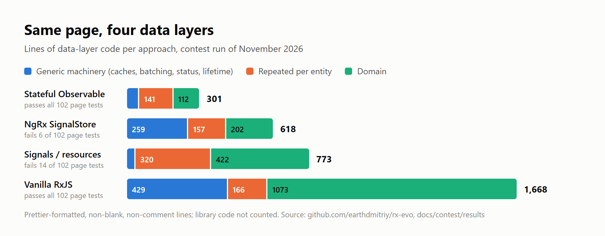

# Same page, four data layers: RxJS vs Stateful Observable vs Signals vs NgRx SignalStore

*301 lines instead of 1668, and what's behind the numbers.*

Many comparisons of state management are built on a todo list or a page with two requests. Every approach looks fine there. The differences show up on a page where data is shared between sections, joined from several services, cached, invalidated by writes, and has to survive a failed endpoint.

So I built one such page four times, with four data layers, and judged all of them with the same test suite:

- plain RxJS, with no library;
- Angular signals with `resource` and `rxResource`;
- NgRx SignalStore;
- [Stateful Observable](https://github.com/earthdmitriy/stateful-observable), my library on top of RxJS.

**About Stateful Observable**, for context. It wraps an RxJS stream so that the stream carries its own loading, error and inactive state, survives errors, is shared by default, and combines with other streams through one fixed rule. Every node has the same handle (`value$`, `pending$`, `error$`, `reload()`), so a page becomes a dataflow graph that you can recover from any node. [Part 1](https://github.com/earthdmitriy/stateful-observable/blob/main/docs/articles/stateful-observable.md) introduces it, and explains why I built it on RxJS rather than on signals or a store. This part is the test.

## The page

An internal support console for a shop. It's the kind of page that usually ends up as one big store with a lot of hand-written glue.



- **13 sections**: sign-in, the agent, notifications, a customer list with search, filters, sorting and pages, a customer header with KPIs, tabs for orders, cart, tickets and notes, shipments in transit, recent activity, and two panels over the page (an order editor and a ticket thread with a reply box).
- **11 backend services**, split the way microservices often are: each owns its data and returns only the *ids* of other services' entities. There's no backend-for-frontend, so the page joins everything itself. A notification like "T-9003: new message from Iva Homenick" needs the notification, the ticket and the customer's name, from three services.
- **21 read endpoints.** Three take ids in batches of at most 20 (`tiers`, `ticketCounts`, `prices`), three take one id per call (`product`, `stock`, `agent`).
- **7 writes** that change what other sections show. Saving an order changes the order, the customer's order stats, the stock of its products, the activity feed and, with a reply, the linked ticket and its counters. Each of those has to refresh, and only those.
- **A push channel** every 25 seconds while signed in, and two sections that poll.
- **35 exported types** in the data contract, and **7 user inputs** that everything else follows from.
- **Two data scopes.** Products, prices and stock are public and kept across sessions. Everything else belongs to the signed-in agent and must be gone after logout.

Showing the right data is only the start. The requirements also cover **progressive loading** (each section renders as soon as its own data arrives), **graceful degradation** (a failed endpoint breaks only the sections that need it), **recovery** (a retry reloads exactly what failed) and **request reuse** (one request per key, cache, batching, nothing requested that isn't shown).

## How it's judged

The contest measures the layer where the business logic lives, so everything else is fixed and shared:

- **The backend** is a fake with deterministic data, a controllable delay, an error switch per service and a counter on every call. A test can hold a request, release it, fail it, and count how many were made.
- **The presentational layer is the same for all four.** The views are dumb components that take view models (data only) and emit user intents. They never fetch or hold data, and they take no status input: each section sits inside a block that shows the spinner, or the error with a Retry button.
- **The tests read what the user would see**, not the data layer: a section's content, the block's loading class, the error and its Retry button. They never look inside an entry, so every approach is judged by the same observable behaviour.
- **Each entry writes only the connection**: its data layer, the view models, and the loading, error and retry fed into the blocks. Only that data layer is counted. Templates are out of scope.

Making the views checkable from the outside, and usable from any approach, took a few iterations. The shared shape still shows a difference in the wiring: a plain block takes four inputs (data, a loading flag, an error, a retry handler), and each approach has to produce all four for every section. In the Stateful Observable entry, a block takes one, `<app-stateful-block [stream]="customer">`, because the stream already carries all four.

The suite has 102 page tests and 104 browser tests, in three stages: **correct data**; **robustness** (a failure stays in its own section, a retry reloads what failed, a superseded request is cancelled rather than ignored, a write refreshes exactly what it changed); and **efficiency** (load only what is shown, one request per key, cache, batching, progressive loading).

**Who wrote the code.** All four entries were written by an AI agent. The Stateful Observable and resources entries were also steered by hand, the Stateful Observable one by me, and the steering log is [public](https://github.com/earthdmitriy/rx-evo/blob/master/docs/contest/steering.md). The vanilla RxJS entry was built from the code of the suite's reference implementation, which was already "no library, done well". It's one page and one run: the numbers measure this page and these entries, not every application.

## Results

From the November 2026 run (page tests and browser tests agree for every entry):

- **Vanilla RxJS**: passes all 102 page tests and all 104 browser tests.
- **Stateful Observable**: passes all 102 page tests and all 104 browser tests.
- **Signals / resources**: fails 14 page tests and 14 browser tests.
- **NgRx SignalStore**: fails 6 page tests and 6 browser tests.

Two entries pass everything. The difference between them is the code it took. Lines are counted for the data layer only (Prettier-formatted, non-blank, non-comment), split into three kinds:



| Lines of code | Vanilla RxJS | Stateful Observable | Signals / resources | NgRx SignalStore |
| --- | --- | --- | --- | --- |
| Generic machinery (caches, batching, status mapping, lifetime) | 429 | 48 | 31 | 259 |
| Repeated per entity (one declaration per cache or lookup) | 166 | 141 | 320 | 157 |
| Domain (sections, endpoints, view models) | 1073 | 112 | 422 | 202 |
| **Whole data layer** | **1668** | **301** | **773** | **618** |

Against the average of the four, the Stateful Observable entry has:

- **51% less extra code** (generic plus per-entity): 189 lines, against an average of 388 and 595 in vanilla;
- **a 64% smaller data layer**: 301 lines, against an average of 840;
- **the cheapest new batched lookup**: 13 lines in 2 files, against 20 lines in 4 files in vanilla RxJS. SignalStore (14) and resources (30) don't batch their lookups.

**A fair objection: isn't vanilla just badly structured?** Most of vanilla's 1668 lines are domain code (1073), mostly one store of about 930 lines that wires sections, endpoints and view models together by hand. A better-organised vanilla entry could be smaller, so the headline number may overstate the case. The machinery doesn't depend on that: 189 lines of extra code against 595. And against the next best entry, SignalStore, the whole data layer is 301 lines against 618, with SignalStore still failing 6 tests. My reading of the domain gap, which isn't measured: when every node carries its own state and recovery, sections read their sources directly, and there's no central store left to wire.

## Why the numbers come out this way

### The machinery is a library, or it's yours

**Vanilla's 429 generic lines are a small library**: a keyed query with sharing, cancellation and polling (116 lines), an entity cache with batching and reference counting (140), and status mapping that keeps the previous value (114). It's good code, but it was written to pass this contest's page and browser tests, and nothing more. In a real project, those 429 lines are a library of your own: they need their own unit tests, documentation and design decisions written down, and someone to maintain them. The line count doesn't show that cost.

**The other two failed where their model ends, and the failures were left on purpose.** All six SignalStore failures are batching. Resources fails the same six, plus eight more, mostly about caching, cancellation and invalidation. Every one of them can be fixed. The question is the cost: each fix needs to know which consumers are still active, and that means re-implementing what RxJS gives natively with subscribe and unsubscribe. Resources has no way to notice that nobody reads it anymore, so on this page caching and cancelling exclude each other. SignalStore already carries a hand-written keyed cache that counts observers in mutable maps, and batching would add about 136 more lines of the same kind. The fixes are possible, but the purity would go: the data layer would grow mutable bookkeeping that the other entries don't need.

### What replaced that code in the Stateful Observable entry

**The 48 generic lines** are a write helper, the session tokens and a two-line lookup helper. Everything else that the other entries wrote by hand is library behaviour or an option:

**Lookups by id: factories.** The backend returns ids, so every row needs its related entity by id. A factory makes the lookup part of the cell. The same id returns the same stream, so 100 cells over 5 distinct ids make 5 requests, a failed id shows an error only in its own cells, and `get(id).reload()` fixes all of them at once. A loaded id is kept for the next visit, and a load nobody waits for anymore is cancelled.

```typescript
const customerById = statefulObservableFactory({
  loader: (id: number) => api.customer(id),
  cacheSize: 200,
});

customerById.get(42);              // one entry per id, shared by every consumer
customerById.project(selectedId$); // a key that changes over time
customerById.projectMany(ids$);    // a list of ids, combined into one stream
```

**Batching: `statefulObservableBatchFactory`.** Same API, and ids requested within a short window go out in one call. That's how `tiers`, `ticketCounts` and `prices` go out as one request per view instead of one per row:

```typescript
const tierById = statefulObservableBatchFactory({
  loader: (ids: readonly number[]) => api.tiers(ids),
  idOf: (tier) => tier.customerId,
  batchTime: 10,
  maxBatchSize: 20,
});
```

**Logout: `active`.** Pass it to the roots that hold user data, and everything derived from them follows:

```typescript
const profile$ = statefulObservable({
  loader: () => api.profile(),
  active: loggedIn$, // Observable<boolean>
});
```

When `loggedIn$` emits `false`, an `inactive` event goes along every edge: requests in flight are cancelled, derived nodes stop replaying the old data, and caches are cleared, including those of streams nobody is reading at that moment. Subscribers stay subscribed, and after relogin the loaders run again for the new user.

**A result cache per input: `cacheKey`.** A source keyed by UI state (a search, a page) serves inputs it has already seen from the cache, synchronously and without a loading event. Errors are never cached, so a retry actually refetches.

## What the pass count hides

- **Switching to another customer.** The vanilla, SignalStore and resources entries blank the customer sections while the new customer loads. The Stateful Observable entry keeps the previous content under the spinner. The tests accept both.
- **Logout.** Vanilla and SignalStore clear 17 user caches by listing them in a logout handler. A resource has no way to drop its value and keep working: in the first version of the resources entry, user data stayed after logout in root singletons, and the steering moved the resources into disposable services provided by the signed-in frame, so logout destroys them. The Stateful Observable entry passes `active` to 14 user-scope lookups and has no logout handler for data.
- **Who writes.** The Stateful Observable entry has 14 imperative writes, and all of them are user input: the selected customer, the tab, the open panel, the edit mode, the credentials. Nothing writes server data. The SignalStore and resources entries also set cached server data by hand after a save.

## Recipes for people and agents

The library ships [recipes](https://github.com/earthdmitriy/stateful-observable/blob/main/docs/recipes.md) and a [quality-of-life guide](https://github.com/earthdmitriy/stateful-observable/blob/main/docs/QoL.md), written for both people and AI agents: where a source lives, how to invalidate the cached values of a subtree (for example on logout), how to batch a lookup, how to refresh what a write changed. In a later check, an agent given the recipes built a slice of the same page (a session, a batched lookup per row, a polled section, a write that refreshes another view) and followed the intended pattern on every point, with no steering.

## More

- Part 1, the library itself: [Stateful Observable: loading, errors and combined data in RxJS without the boilerplate](https://github.com/earthdmitriy/stateful-observable/blob/main/docs/articles/stateful-observable.md)
- The contest: [rx-evo repository](https://github.com/earthdmitriy/rx-evo/blob/master/docs/contest/README.md), the running entries on [GitHub Pages](https://earthdmitriy.github.io/rx-evo/contest/idea), and the full [results](https://github.com/earthdmitriy/rx-evo/tree/master/docs/contest/results) with evidence for every cell
- A detailed comparison with vanilla RxJS, signals and resources, and NgRx SignalStore: [compare.md](https://github.com/earthdmitriy/stateful-observable/blob/main/docs/compare.md). It was written by an AI agent that I challenged claim by claim, and it lists where the library loses. TanStack Query is mentioned there only briefly, from its documentation: it wasn't built or tested.

TanStack Query is the obvious missing entry. The kit is open: the backend, the views and the suite are shared, and an entry writes only its data layer. If you'd like to see it, or another approach, in the contest, [open an issue](https://github.com/earthdmitriy/stateful-observable/issues). And if the numbers were useful, star the [repo](https://github.com/earthdmitriy/stateful-observable).
