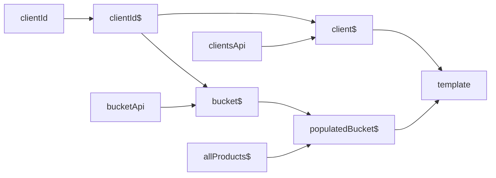

# Comparing approaches to async state

How do you load data, show a spinner, survive errors and combine several sources? This article compares four common answers:

1. Vanilla RxJS
2. `statefulObservable`
3. Angular signals, including `resource` / `rxResource`
4. A store, with NgRx SignalStore (`@ngrx/signals`) as the example

## Origin of this document

This comparison was written by an AI agent (Claude) that was asked to produce an honest comparison of different approaches to async state. The agent did not know this library beforehand. The library's author gave hints about its purpose and intended capabilities (deterministic dataflows without mutation or side effects; combining streams in many different ways; graceful degradation and recovery when an endpoint fails; business logic not buried under boilerplate; and, added later, low resistance for writing modular, atomic code), pointed the agent at a real application as the running example, and then challenged the draft claim by claim.

Claims about the library were checked against its source and tests. Claims about other tools were checked against their documentation or source where possible. The places where the first version was wrong are listed, with the original claim, in a separate [corrections log](./compare-corrections.md). In the text, "I" means the agent.

## Read this first

- **The criteria below are the ones the library was built for**, as given by its author, so it scores well on them by construction. Section "Criteria it does not optimize for" lists where the library is weaker or deliberately absent.
- **Why these alternatives.** Each one stands for a kind of answer: the baseline the library is built on (plain RxJS), what the framework ships (Angular signals and resources), and popular modern libraries (NgRx SignalStore, and TanStack Query under "Other alternatives"). Many other state libraries exist (RxAngular state, Elf and others); they are not covered, to keep the comparison bounded, and nothing here says how they compare.
- **Versions.** `statefulObservable` 0.8.0 (pre-1.0; history in the [changelist](./changelist.md)). The contest below used this version. Statements about Angular resources were first checked against the Angular 20 documentation and source, and the guide at angular.dev was read again in November 2026, which changed some of them (see section 3). NgRx SignalStore is `@ngrx/signals`. Classic `@ngrx/store` (actions, reducers, effects, selectors) is mentioned only where it differs. Check the docs for your versions.
- **What kinds of evidence are used.** Where it matters, a claim carries one of these tags:
  - *(ran)*: throwaway probes against the library and plain RxJS, deleted afterwards, so the numbers cannot be reproduced from the repository.
  - *(contest)*: one page built with each approach and judged by one test suite, kept in the [rx-evo repository](https://github.com/earthdmitriy/rx-evo/blob/master/docs/contest/README.md) so it can be rerun (see "Measured on one page").
  - *(tests)*, *(source)*: the library's own tests or source. They show the library does what it says, not that alternatives cannot.
  - *(docs)*: official documentation or source of another tool, read at one point in time.
  - *(secondary)*: blog posts, forum threads, search snippets.
  - *(author)*: the library author's experience or opinion.
  - *(reasoned)*: an inference that was not tried.
  - *(unverified)*: common knowledge or an assumption, with no source checked.

  Untagged statements about other tools are readings of their documentation, not tests: "DIY" means I did not find the thing provided, not that I built it and measured the cost. Where a claim is tagged *(contest)*, the thing was built, tested and sized.
- **Examples are Angular-flavoured** because that is where the library was born. `statefulObservable` itself only depends on RxJS. The glue in the samples (a stateful block component, the async pipe, `toSignal`) is per framework and is written in each one; use with React, Vue or others was not examined here.

## The author's perspective (experience, not evidence)

The weighting of the criteria below comes from more than twelve years as a software engineer, not only as a frontend developer:

- **Functional programming.** An early interest (Akka, Scala). Working as a C# developer, the author used patterns from it, such as functional error handling, which later became the foundation for the graceful-degradation criterion.
- **Rx.NET and LINQ for data streams** showed that much of what is usually solved with imperative code can be written declaratively.
- **Moving to frontend**, the author was frustrated by how many problems in JavaScript code appear only at runtime, and started looking for ways to make frontend code reliable and strongly typed, as in other mainstream languages.

Specific criteria come from problems that recurred across several projects:

- **Eagerness** leads to unnecessary requests, and they are sometimes hard to deal with. It is why laziness (requests start when something consumes them) is a criterion here.
- **Mutation makes debugging hard.** An entity passed by reference and mutated somewhere else can cost hours of debugging, or days when the state it produces is rare.
- **Huge classes with many mutable properties are very hard to test and debug**, which is why the author prefers to write logic as deterministic data streams.
- **Stores are another kind of mutable class.** Actions can be traced in devtools, but who invoked an action? Potentially any part of the code can invoke it and mutate state, and overpopulated stores made the dataflow untraceable even with the devtools in use. This experience is with the classic action-based store; a SignalStore with protected state narrows the writers to its own methods (section 4), which is a smaller version of the same problem.

  "Traceable" covers three different questions. *What happened*: a devtools log shows it. *Which call site dispatched it*: only with the opt-in `trace` option and a developer attached to a running session with access to the store. *Who is able to dispatch it*: any code that can reach the dispatcher, which only reading the code answers. In a bug reported from the field the first two are usually unavailable, since devtools are typically used in development sessions and not in production *(unverified)*. The third question remains, and the suspects are every piece of code that can invoke the action. In a pure graph, as long as the purity actually holds, only what can reach the start of the event chain can affect a value, which narrows the search to the sources and the code that writes to them. It is why traceability and small, isolated units are criteria here.

The overpopulated-store problem is recognised beyond those projects (see below). Its cause is contested: one view is that slices can be kept small and decoupled, so overpopulation is misuse of a store; the other is that keeping them small takes extra effort, so the cheapest path leads the other way, which is the "path of least resistance" test this document applies to the library. The sources below show that the problem occurs, not how often or why.

What a search of docs, blog posts and forum threads found (practitioner opinion, not measurement):

- **Overpopulated stores are recognised.** The [Redux FAQ](https://redux.js.org/faq/organizingstate) says local component state is fine and gives rules of thumb for what belongs in a store. A [post on common NgRx mistakes](https://medium.com/briebug-blog/3-ways-youre-using-ngrx-wrong-6cc6e085d151) calls local UI state in the global store "intent is local, implementation is global". Both frame it as misuse of a store.
- **Untraceable origin is acknowledged, and the mitigation has conditions.** An [article](https://dev.to/bnevilleoneill/redux-devtools-tips-tricks-for-faster-debugging-2afn) says repeated actions from many places hide the root cause. Redux DevTools and NgRx's [store devtools](https://app.unpkg.com/@ngrx/store-devtools@20.0.0/files/src/config.d.ts) can record a stack trace for every dispatched action, but only when the opt-in `trace` option is on, with a developer attached to a running session and able to reach the store. That tells which call site did dispatch an action, not who can. For a bug reported from the field those conditions are typically not met *(unverified)*. The `trace` option and its default (off) come from the `@ngrx/store-devtools` 20.0.0 type definitions and its configuration guide *(secondary)*; its behaviour in `logOnly` mode was not checked. These are the classic store's devtools; for SignalStore, Redux DevTools integration comes from a community toolkit *(secondary)*.

Most of these sources come from the Redux world, where a store is the usual container for shared state. Angular already has component classes and services for that, so the same mistakes look different there. The Redux docs themselves now make RTK Query the default for data fetching ([tutorial](https://redux.js.org/tutorials/essentials/part-7-rtk-query-basics)).

## Criteria the library optimizes for

The criteria below share one foundation: **graph-shaped dataflow**. When each piece of UI is a leaf that depends only on the sources it needs, progressive loading, graceful degradation and error recovery follow from the topology itself: a leaf renders when its own sources answer, a failure blocks only its descendants, and recovery runs through the same edges. The library's aim is to make building such a graph cost nothing extra, so that this topology is the cheap default rather than plumbing written per layer.

1. **Deterministic, trackable dataflows.** Derived data is described by pure pipes over other data, not by imperative updates. Every derived value has exactly one producer, so its origin is found by following references. The graph is the uniform structure: every piece of dataflow is an isolated wire (source, pipes, combine) exposed through the same handle (`value$`, `error$`, `pending$`, `reload`), which is meant to make it easy to read and track regardless of who wrote it (a design intent, not a measured result). The usual weakness of writable shared stores is that anyone can write, which makes the source of a value hard to establish. The claim about writers here has three steps:
   - **No tool can forbid it.** A side effect can be written anywhere the language allows: in any operator, in a subscription, in a `computed`, in a mutable closure. No library or approach prevents that, and this one does not try. The goal is less ambitious: make side effects as rare as possible by default, so that each one breaks the code style and is felt as a code smell. Writers exist at the sources you declare (a `Subject`, a form control or a signal feeding `input`), they are explicit, and their reach is as wide as the references to them.
   - **So the question is what the default path contains.** A value derived with a plain RxJS `pipe` or a `computed` signal has no write API either. The usual reason derived state acquires writers is exposing its status: loading and error flags mutated from `tap`, whether as fields, signals or Subjects (the first sample in section 1). In the author's experience this is common practice; a rough code search supports that it is widespread (see "Purity is the path of least resistance"). Among signals, `linkedSignal` is a derived value that is writable, and resources expose `set` / `update` (the current guide lists a `local` status for a value set that way).
   - **Here that reason disappears.** Pending, error and inactive are derived from the loader, so the status of a derived node has no writer either, and no code is written for it. In vanilla RxJS the same result is DIY: a `withState`-style operator you write, test and maintain. This is the DIY versus first-class line used throughout, and "first-class" means provided, not enforced.

   **Triggers and writes are different questions.** Any holder of a handle can call `reload()`, as any holder of a store can call its load method. A trigger reads the source of truth again, so the result is still a projection of it; the cost of an unwanted trigger is extra requests, pending states on every screen that shares the source and, with `switchMap`, a cancelled in-flight request, not wrong data. A write (`patchState`, `set`, `update`) replaces the projection with a value the source never produced, and that is the writer this document is concerned with. A connection (`statefulConnection`, see [QoL](./QoL.md)) is the same kind of decision at the level of wiring: `connect` chooses which source a slot projects, a helper for dynamic subgraphs, not a write of a value. The distinction rests on the author's premise that a frontend owns no source of truth except user input, and every other piece of UI is a projection of an API endpoint *(author)*. It does not hold for state the client really owns (drafts, offline or local-first data), which is out of scope here (see "Criteria it does not optimize for").

   This is a design argument about defaults, not a measurement and not a guarantee; see "Purity is the path of least resistance" for what it rests on and what would count as evidence. The aim is to help keep **business logic** free of side effects and mutation, which makes it more predictable and reliable. The library does not claim to be side-effect free itself: some effects are unavoidable (it keeps a cache and, by default, logs unhandled errors to the console).
2. **Streams are combined in many ways.** Some sources are shared app-wide (a root token or service), some combinations live in a feature service or another token, and a component can collect any of them in any combination without anyone declaring the combination in advance.
3. **Graceful degradation in complex dataflow.** Any endpoint can fail, and in a graph of derived and combined data the failure has to stay where it happened: it blocks only its descendants, it says which source failed, and the graph has a path back. Handling loading and error for one request is simple in every approach and is not counted here.
4. **Business logic stays visible.** Handling the above should not bury logic under boilerplate. In particular, the state of the whole graph (pending, error, inactive) and the ability to recover it come out of the box at every derived node, with no code written per layer. Other approaches can reach the same result, but only by writing and maintaining that plumbing; see "Recoverability of derived graphs".
5. **Low resistance to highly modular, atomic code.** Making a small, single-purpose unit of data (one source, one transformation, one combination) should be cheaper than adding it to something big. A unit is declared in one place, has the same handle as every other unit, and joins the graph by reference, so splitting, moving or reusing it does not require touching a central registry.

## Criteria it does not optimize for

These matter in real projects and are where other options win or where `statefulObservable` has nothing to offer:

- **Shared mutable state.** Many places updating one piece of state, patching cached data in place (optimistic UI is still possible as an overlay; see "No write path, by design"). This is excluded on purpose. The project's stated reason (readme, "How is this different from a global state manager") is that global state couples an application tightly, which makes it fragile and hard to debug, and makes it difficult to trace where a piece of data comes from. Its alternative is atomic, feature-specific states, kept granular and co-located, so the source of any value is known. That is a position and not a measured result (see "The author's perspective"). If your problem needs shared mutable state, this library is the wrong tool and a store or signals are right.
- **Composing events.** Deriving actions or side effects from one event or a set of events ("something happened", with or without a payload): debouncing, merging several streams, sequences and time windows. This is plain RxJS territory; `statefulObservable` is about state derived from data, not about events. Events can feed it as inputs, and it does not get in the way.
- **Runtime inspection.** Devtools, time travel and an audit log of what happened are not part of the package, and this is a decision, not an oversight. A prototype worked: an RxJS operator that sent each emission to the Redux DevTools extension as an action. It was not shipped. The author's reasoning, which I did not verify, is that a proper integration does not belong in a platform-agnostic core: it has to be wired in at compile time, so it would take a separate package for each framework (Angular, Vue, React and so on), and each of them has to be on in development builds and absent from production, which needs deep integration with that framework's build tools. Needing the browser extension is the smallest part of the problem. In the meantime what exists is structure, not runtime: a static diagram of the dataflow (see "Dataflow as a diagram"), and the `name`, `meta` and `log` options that a future integration would attach to.

- **Server-side rendering.** The library has no SSR feature of its own and relies on what RxJS and the framework do; see "Server-side rendering" in section 2 for what that is expected to mean in Angular. It was not tested.

Maturity and ecosystem matter in practice too, but they are not design criteria: they are not something the library is shaped for or against. They are stated as facts in the table and in the problems list.

## The running example

A client page that:

- loads a client when `clientId` changes,
- loads the client's bucket for the same id,
- shows a bucket enriched with a product catalog (the catalog is a shared, app-wide source; the client and bucket belong to the component),
- shows a spinner while loading and an error if something fails,
- keeps the previous content on screen while new data loads,
- recovers when the user picks another id after a failure.

The samples show the bucket and the catalog, which is where the approaches differ. The client is a single request on the same id; it appears only in the `statefulObservable` sample (and in its diagram), and in the other approaches it would be one more `withState`, resource or store method without new problems. Recovering on a new id after a failure is single-request error handling, which every approach here does (criterion 3), so it is not shown separately.

## 1. Vanilla RxJS

**The main point of this chapter.** At first glance the problem looks solvable with a few operators and utilities, and a first version takes minutes. The rabbit hole is deep, though: a reliable solution takes a deep understanding of RxJS. The sections below show where it goes down, most traps measured on running code and one (operators on wrapped values) taken from the ADR's analysis: a missing `shareReplay` that turns every extra subscription into another request, emissions that multiply and the equality that is needed to filter them, operators that have to know about wrapped values, combination rules that must be chosen and applied the same way everywhere, recovery that has to be wired by hand, and lifetimes that cannot be reset from outside.

RxJS has no concept of loading or error as data: an `Observable<T>` carries values, and an error terminates it. Everything else is built by you. A naive attempt uses side-effect subjects:

```typescript
const loading$ = new BehaviorSubject(false);
const error$ = new BehaviorSubject<unknown>(null);

const client$ = clientId$.pipe(
  tap(() => { loading$.next(true); error$.next(null); }),
  switchMap((id) =>
    this.api.getClient(id).pipe(
      catchError((e) => { error$.next(e); return EMPTY; }),
    ),
  ),
  tap(() => loading$.next(false)),
  shareReplay({ bufferSize: 1, refCount: true }),
);
```

This works for the happy path, but it is a poor baseline: the flags are mutated from several places, and a failure path that forgets to reset `loading$` leaves the spinner on. **A competent RxJS developer would not write it this way.** The stronger vanilla version writes the state machine once as an operator:

```typescript
type State<T> = { loading: boolean; value?: T; error?: unknown };

const withState =
  <I, O>(load: (input: I) => Observable<O>) =>
  (input$: Observable<I>): Observable<State<O>> => {
    const initial: State<O> = { loading: false };
    return input$.pipe(
      switchMap((input) =>
        load(input).pipe(
          map((value) => (): State<O> => ({ loading: false, value })),
          catchError((error) => of((s: State<O>): State<O> => ({ ...s, loading: false, error }))),
          startWith((s: State<O>): State<O> => ({ ...s, loading: true, error: undefined })),
        ),
      ),
      scan((state, update) => update(state), initial),
    );
  };
```

That is a dozen lines, keeps the previous value while loading, survives errors, and has no external mutation. For a single stream it is a legitimate answer, and it is fully under your control.

**A note on the `startWith` line, a tradeoff.** It copies the previous state with `loading: true`, which keeps the last value on screen and avoids wiping the UI. The price is that every request emits a new state object when it starts and another when it ends, so subscribers receive additional events and potentially re-render. Measured with two sequential requests: the operator emitted four states, a subscriber mapping them to the value received four values, and the previous value was re-emitted, with the same reference, when the next request began. `distinctUntilChanged` can remove the repeats, with nuances. On the extracted value of a single stream a reference comparison is enough, since the same object comes back. On a combined value it is not: the projection rebuilds the object on every emission, so equal results pass as new ones (in a run with a combination, a reference-based `distinctUntilChanged` passed three defined values for two distinct results). On the state wrapper itself every emission is a new object by construction. Those cases need a deep or custom comparator, which has its own cost and pitfalls, and it is one more thing to remember at every consumer. `statefulObservable` keeps value, pending and error as separate streams, so in the same run `value$` emitted twice.

### The running example in vanilla RxJS

The operator above is the easy case: one stream. The running example also has a **combination** (the bucket with the product catalog) and **shared data held in a service** (the catalog). Here is what that takes with the same `withState`. This code type-checks under `strict` and was run.

```typescript
// a combination of two states: another helper you write
const combineStates = <A, B, R>(
  a$: Observable<State<A>>,
  b$: Observable<State<B>>,
  project: (a: A, b: B) => R,
): Observable<State<R>> =>
  combineLatest([a$, b$]).pipe(
    map(([a, b]): State<R> => {
      const error = a.error ?? b.error;
      return {
        loading: a.loading || b.loading,
        error,
        value:
          !error && a.value !== undefined && b.value !== undefined
            ? project(a.value, b.value)
            : undefined,
      };
    }),
  );

// shared data in a service
@Injectable({ providedIn: "root" })
export class CatalogService {
  private readonly api = inject(ProductsApi);
  private readonly reload$ = new BehaviorSubject<void>(undefined);

  readonly products$ = this.reload$.pipe(
    withState(() => this.api.allProducts$()),
    shareReplay({ bufferSize: 1, refCount: true }), // a lifetime decision
  );

  reload() { this.reload$.next(); }
}

// the component
export class BucketPage {
  private readonly api = inject(BucketApi);
  private readonly catalog = inject(CatalogService);
  private readonly reloadBucket$ = new BehaviorSubject<void>(undefined);
  readonly clientId$ = new BehaviorSubject(1);

  readonly bucket$ = combineLatest([this.clientId$, this.reloadBucket$]).pipe(
    map(([id]) => id),
    withState((id: number) => this.api.getBucket(id)),
  );

  readonly populatedBucket$ = combineStates(
    this.bucket$,
    this.catalog.products$,
    (bucket, products) => prepareBucket(bucket, products),
  );

  // the recovery of the derived handle, composed by hand
  reloadPopulatedBucket() {
    this.reloadBucket$.next();
    this.catalog.reload();
  }
}
```

Run with a failing catalog and then a reload, the combined state went through: loading, then **loading and error at once** (the catalog failed while the bucket was still loading), then error alone, and after `reloadPopulatedBucket()` loading again and finally the value. Both sources were requested again.

What you wrote beyond the single-stream operator:

- **The combining helper.** It works for two sources. For N sources of different types you need variadic tuple typing (RxJS's own `combineLatest` does it with mapped tuple types), which is doable but is more type-level code to write and test.
- **The rules.** The helper emits `loading` and `error` together. That is a property of this minimal helper and a competent version would fix it in a line (for example, suppress `error` while anything loads); the point is that someone has to choose a rule, test it and apply it the same way in every combination. The combined `error` is the first one found, so this helper does not say which source failed; returning a tuple of errors would, at the cost of more types.
- **The recovery plumbing.** A reload subject per source and a method that composes them. The template has to call that method, and adding a source to the combination means remembering to update it.
- **The sharing decision.** `refCount: true` releases the catalog when nobody reads it; `false` keeps it for the life of the application, including across a logout (see [QoL](./QoL.md), "Active and inactive state").
- **What it still does not carry:** error types per source, or an inactive state across the graph.

None of this is hard, and all of it can be written once per team. The point is that it is written, tested and kept consistent by you, and that the work grows with the graph.

### What the two helpers do not cover

`withState` and `combineStates` are the kernel, not the library. For one page with two sources they are enough, and then there is little reason to adopt anything. The rest of `statefulObservable` is what the example leaves out, and each item below is something a graph tends to need as it grows:

- **Dependent steps.** A second request that depends on the first is the chain problem described under "Problems" in the evaluation below: without help, every operator after the wrapper has to know about the state. `pipeValue` and `pipeError` apply ordinary operators to the value or to the error and pass the state through, and they take higher-order operators too.
- **N sources, typed.** `combineStatefulObservables` takes any number of sources, keeps the value types as a tuple, and reports errors as a tuple with one entry per source, so the failed source is named (for a tuple of sources; an array whose length is not known gives weaker types, see section 2). The helper above does two, and says only that something failed.
- **Fixed combination rules.** Priority is inactive, then pending, then error, then value, applied the same way at every combination. In the example the helper reported `loading` and `error` together.
- **Recovery of any handle.** One `reload()` reaches every source behind a derived node; `reload({ onlyFailed: true })` reaches only the failed ones, and `reload({ where })` only the ones whose name or meta matches. `onlyFailed` needs each source's latest state at reload time, tracked without keeping the sources alive, which is its own piece of code and its own tests.
- **Taking user data out.** `active` cancels in-flight work, signals inactive along every edge and clears the result cache, also of streams that nobody is reading at that moment (see "What `active` covers" in section 2). `shareReplay` has no reset signal, so in plain RxJS clearing its buffer from outside means restructuring the stream (for example recreating it on a reset trigger), which is code you write (see [QoL](./QoL.md), "Active and inactive state").
- **Caching and addressing by key.** A result cache with least-recently-used eviction, and a factory with one stream per key, deduplicated across consumers, bounded by `cacheSize` for entries nobody is subscribed to, and resettable. A batch factory collects the ids asked within a window into one call of a batch endpoint, with the same API.
- **Diagnostics and interop.** Node names and positions in error messages, a console error when nobody listens to `error$`, serializable events, and acceptance anywhere an Observable is expected.
- **A test suite** for all of the above.

So the two helpers are **the entrance to the hole**, not a way around it. Even for one page, the traps above (re-emissions and equality, wrapped values in higher-order operators, combination rules, lifetimes) take real RxJS understanding to get right. The library is what the helpers become once those answers have been found, written, tested and maintained in one place. So what "first-class" buys is not a capability that RxJS lacks: it is one consistent, tested behaviour at every node of the graph (one combination rule, per-source errors, recovery and the inactive state everywhere), instead of a version that each team and each combination writes slightly differently. Whether to write that yourself is the build-versus-adopt question, and the project's own history is one data point: it started as an operator like `withState` and became a library as these needs appeared (see the [ADR](./adr.md)).

### Evaluation

**Features**

- **Cold and lazy.** A declaration does nothing until something subscribes. `@if` plus an async pipe starts the request on expand and stops it on collapse.
- **Keeps the old value by default.** A plain `switchMap` emits nothing when a new request starts, so a rendered value stays. Wiping appears only if someone adds it (`startWith(null)`) or implements a state operator wrongly.
- **Composing events is what it is for.** Deriving actions or side effects from one event or a set of events (debounce, merge, sequences, time windows, "A then B within N seconds") is the native use of RxJS, and nothing else in this comparison does it better.
- **Maturity and control.** It is the foundation of everything else here, has no extra dependency, and is the right tool for sockets, polling and multi-step orchestration.

**Problems**

- **Chains: higher-order operators on wrapped values.** The moment a value is wrapped in a state, every operator after the wrapper has to know about it. A plain `map` needs bypass branches (`if (isLoading(x)) return x`). Higher-order operators are worse: in a `mergeMap` the loading and error markers have to be passed through as observables of their own, and a `concatMap` in that place behaves incorrectly (this is the ADR's analysis, written by the library's author; I did not re-run it. See "Why not use a single pipe to rule them all?" in [Chaining and pure RxJS interoperability](./adr.md#chaining-and-pure-rxjs-interoperability)). The other way out is to wrap each dependent step in its own state and merge the states by hand. Either way, a second request that depends on the first (`switchMap` to the next call) is where the state starts leaking into every operator.
- **Cold by default: a missing `shareReplay` multiplies requests.** Every subscription runs the whole pipeline again, so a stream bound in a template with several async pipes (the value, the pending flag, the error) sends one request for each. Measured with the operator above: three subscriptions made three requests, and one request with `shareReplay`. Adding it is easy to forget and then brings its own decisions: the lifetime (`refCount`) and the fact that `shareReplay` itself has no reset, which matters at logout (see [QoL](./QoL.md), "Active and inactive state"). `statefulObservable` shares by default: its `value$`, `pending$` and `error$` together made one request in the same kind of run.
- **A failure is not data.** The error channel ends the stream and is untyped (`unknown` or `any`). Turning loading and error into states, keeping the stream alive and typing the errors are all yours; the `withState` operator above writes it once for one stream.
- **A complex dataflow does not degrade gracefully by itself.** An error in one branch of a `combineLatest` ends the combined stream and every consumer below it. Keeping the failure local, carrying pending, error and inactive across each edge, naming which source failed and recovering a subtree are all written per edge, and the work grows with the graph.
- **Combining statuses** ("pending if any is pending", "which error wins", typed per-source errors) is hand-written. Each team chooses a rule, and then has to test it and apply it the same way in every combination; usually each writes it slightly differently, and the trade-offs of the rule (a partial error shown early, or a complete one shown late) are decided case by case.
- **No shared shape.** Each unit invents its own state shape, so units do not plug together without adapters, which raises the cost of adding and of reusing a small unit. There is no uniform structure, and the origin of a value depends on discipline.
- **Key-based result cache and reload are DIY**, including recovering a derived handle layer by layer. On the contest page this is about 400 lines of generic code: a keyed query with sharing, cancellation, polling and keep-on-error (119 lines), a per-id cache with batching (136) and the status mapping; with them every scenario passes *(contest)*.

Most of these are a build-versus-adopt decision, not a technical limitation of RxJS: the `withState` operator above is the same idea as `statefulObservable`.

**Pick this when** your cases are few or unusual (websockets, polling with backoff, multi-step orchestration), you want zero dependencies, or your team already has its own state operator.

## 2. statefulObservable

The same scenario, in three layers. Each layer is a stateful observable, so layers compose without ceremony.

**Shared source** — an app-wide token. Errors are narrowed, typed and reported once, at the source:

```typescript
export const allProductsToken = new InjectionToken("allProducts", {
  providedIn: "root",
  factory: () => {
    const api = inject(ProductsApiService);
    return statefulObservable({
      loader: () => api.allProducts$(),
      name: "allProducts",
      refCount: false, // app-lifetime data: keep it without subscribers
    }).pipeError(trackError("products"));
  },
});
```

`trackError` stands for a custom RxJS operator that you write once; it is not part of the library. It narrows the error with type guards into a typed union, reports it (for example to Sentry) tagged with the name of the source, and passes the typed error on. The node's stream is shared, so the report runs once per error event at that node, not once per consumer.

**Component** — picks whatever it needs, in any combination:

```typescript
private readonly clientId$ = statefulObservable(toObservable(this.clientId));
private readonly allProducts$ = inject(allProductsToken);

public readonly client$ = this.clientId$
  .pipeValue(switchMap((id) => this.clientsApi.getClient$(id)))
  .pipeError(trackError("client"));

private readonly bucket$ = this.clientId$
  .pipeValue(switchMap((id) => this.bucketApi.getClientBucket$(id)))
  .pipeError(trackError("bucket"));

public readonly populatedBucket$ = combineStatefulObservables(
  [this.bucket$, this.allProducts$],
  ([bucket, products]) => prepareBucket(bucket, products),
);
```

**Template** — one generic block per stream:

```html
<app-stateful-block [stream]="populatedBucket$">
  @if (populatedBucket$.value$ | async; as bucketData) {
    <app-client-bucket [bucket]="bucketData"></app-client-bucket>
  }
</app-stateful-block>
```

The template reads `populatedBucket$.value$ | async`, which delivers values only, while the block handles pending and error. `populatedBucket$ | async` also works and delivers the same values, but it subscribes to the stream itself, so each failed load is also reported to Angular's `ErrorHandler` (see the caveat at the end of section 3). Which one fits depends on the project's error-reporting strategy; the library does not prescribe it.

`<app-stateful-block>` is a pattern, not part of the package: a component you write that subscribes to `pending$` and `error$` of the stream it is given and shows a spinner or an error view around its content. An extended version also listens to the active state (`subscribe({ pending, error, active })`) and removes its projected content on `active(false)`, so a block that does survive a logout does not keep showing the previous user's data. No built-in is provided because the library is framework-agnostic, and the block depends on the project's UI kit and error-handling strategy. It is written once per project, as the error and loading markup is in the other approaches.

What is user code in the samples, so the comparison stays even: `withState` and `combineStates` (section 1), `trackError` and `<app-stateful-block>` (here), `combineResources` (section 3). `combineStatefulObservables` is part of the library; it is the counterpart of `combineStates` and `combineResources`.

A feature service can expose its own combinations as well (for example a factory's `projectMany` over a list of ids, which combines their entries like `combineStatefulObservables`), and a component can combine those with its own streams and root tokens. See [recipes](./recipes.md).

### Evaluation: features (checked against source and tests, except where marked as a design argument)

- **Graceful degradation in a complex dataflow.** Pending, error and inactive are states that travel along every edge (pipes and combinations), so a failure blocks only its descendants and every other leaf still renders. A combined node says which source failed (typed per source), one `reload()` recovers the subtree behind a handle (`onlyFailed` or `where` narrow it), and `active` takes user-bound data and everything derived from it out together. By design a combination means "needs all of these", so data that is merely nice to have belongs in its own leaf.
- `value$`, `pending$` and `error$` are derived from one cached raw stream, so a new `pending` event does not clear the previous value, nor the previous error: `error$` skips pending events, so an error view stays on screen during a retry until a value or a new error arrives. What to show during the retry is left to the UI, as with keeping content during a reload: the stateful-block pattern used here keeps the error visible under a spinner overlay, so the user sees that a request is in progress and that the error may be outdated; the skeleton template in the [recipes](./recipes.md) (`@if` pending, `@else if` error) hides it while pending instead. Both are UI choices. In a template, reading `value$`, `pending$` and `error$` separately does not show inconsistent combinations, since all three come from one shared stream and the view is rendered after change detection *(reasoned, for Angular's async pipe)*; a value computed in code from two of them can (see the overlay under "No write path, by design").
- Errors in pipes are caught per node and re-emitted as error events. The stream keeps running and handles the next input: with `pipeValue(switchMap(...))` and inputs `"not ok"`, `"ok"`, an inner request that fails for the first gives an error event and the second still gives its value (`tests/operators.spec.ts`, "error recovery"). Concurrency is the operator's own: `switchMap` drops the in-flight inner request when a newer input arrives, `mergeMap` runs all of them (same file, "follows the operator's own concurrency").
- **An unread error is reported.** If nothing subscribes to `error$`, a failure is logged with `console.error`, with the node's name and position. In the other approaches an error field or `error()` signal that nobody reads is silent; a resource's error does not reach `ErrorHandler` either. This matters for graceful degradation: the aim is that a failure on a secondary endpoint covers only the related part of the UI with an error block, so an error nobody displays is a missing error block, and a global handler cannot tell which part of the UI should show it. This default is a development signal, not the error-reporting path: errors are reported to Sentry or similar with `pipeError` at the source (as `trackError` does above). The `log` option is a general tracing hook: attached to a root node, it traces all its descendants at once, where plain RxJS would need a `tap` at each step (the devtools prototype under "Runtime inspection" was built on it). Supplying your own `log` callback replaces the `console.error` default, so a custom logger has to report unread errors itself.
- Operators in a pipe run as one pipeline, so stateful operators (`scan`, `distinctUntilChanged`) work as in plain RxJS, while an error thrown inside becomes an error event and later values are still processed. A result that arrives after a newer loading or error event is dropped, so an outdated response does not overwrite a newer state.
- `combineStatefulObservables` is typed: values are a tuple, and the combined error is always a tuple with one entry per source, `false` for a source that did not fail and its typed error otherwise (`[false, "boom"]` in `tests/combineStatefulObservables.spec.ts`). Nested combinations give nested tuples, with the same positions that `reload({ path })` takes. The tuple types hold when the sources are passed as a tuple (an array literal). For an array of unknown length (`StatefulObservable<R, E>[]`), values are typed `R[]` and errors `E[]`, so the `false` entries that are there at runtime are missing from the type *(source)*.
- **Stale data tearing is partly prevented: for asynchronous data, where the library joins it.** When logic combines original data with data derived from it asynchronously, a plain combination can briefly pair the new original with the old derived value (or the reverse), and the UI shows a mix that never existed. The library covers the two places where it joins data:
  - *`combineStatefulObservables`: a loading source holds the combination.* The combination emits on every source change, like `combineLatest`, but while any source is pending it emits pending instead of combining a new value with that source's old one. With asynchronous sources this removes two kinds of outdated combination that plain `combineLatest` emits: one input feeding a fast and a slow request, and a result that lands while another source starts loading (`tests/vanillaParity.spec.ts`, "differs by design"). It does not remove every intermediate combination: synchronous sources can still tear (see "Recoverability of derived graphs"), which the library accepts, since it is built for asynchronous data.
  - *A factory projection joins a value with what was loaded for it.* `project(input$, { combine })` and `projectMany(ids$, { combine })` compute the result from the response and the value (or list) it was loaded for, so data that is not part of the key never meets the response of another key; a new value with the same key runs `combine` again without a request *(source)*.
- **One combination rule everywhere.** Inactive, then pending, then error, then value, at every combination. An error event is emitted only when every source has settled, so it describes the full available state and is never partial or repeated; the price is that a slow source delays the error of a combination that can no longer succeed. The alternatives and the reasoning are in the [ADR](./adr.md#priority-of-states-in-a-combination).
- Cached raw streams use `shareReplay` with `refCount` by default, so a stream is lazy and releases its source when nobody is subscribed. For a collapsed-section UI this means no extra code: with the stream consumed under an `@if` (an async pipe, or a stateful block that subscribes), the request starts when the section is first expanded and is released when it collapses. Expanding again repeats the request unless it is served by a `cacheKey` cache, a factory entry that kept its last value, or a shared stream. For shared data the lifetime is a choice, as it is in every approach: `refCount: false` keeps a source after its first subscription, an operator in `.pipe(...)` can keep it too (`.pipe(shareReplay(1))` for good, `share({ resetOnRefCountZero: () => timer(ms) })` for a grace period; `tests/pipeLifetime.spec.ts`), and `statefulObservableFactory` bounds per-key streams with `cacheSize` and drops unused ones with `reset(false)`. That bound applies to unused entries only: an entry with subscribers is never evicted, so while more than `cacheSize` keys are in use the factory holds more than `cacheSize` streams *(source)*.
- It implements `InteropObservable`, so the async pipe, `toSignal`, `firstValueFrom` and similar accept it. Interop is meant to deliver data directly to a consumer, without the state information. An error event reaches that consumer's `error` callback, and the stream keeps going: a later value is delivered after it (checked with a probe and in `src/subscribable.ts`). That is outside the usual Observable contract on purpose: the library treats a stream that stops on the first error as a design gap of vanilla RxJS (see the [ADR](./adr.md#error-events-in-subscribe-and-interop)). Passing the stream into RxJS operators (`combineLatest([from(stream)])`) is possible but not what interop is for, and there the first error ends the consumer's stream as usual. To combine, use `combineStatefulObservables`; to show states, use `value$`, `pending$` and `error$`. The library's own `subscribe` extends the Observable contract so that one subscription can track every event when needed *(source)*: a function receives successful values only, and an observer object may add `pending(isPending)` and `active(isActive)` callbacks to `next`, `error` and `complete`. In imperative code at the edge (a save result, a side effect after success) this replaces separate subscriptions to `value$`, `pending$` and `error$`.
- **Purity is the path of least resistance.** A side effect can be written anywhere the language allows (in any operator, in a subscription, in a `computed`, in a mutable closure), and no library in this comparison can forbid it; reducers, selectors, `computed` and pipes are all caught by code review, not by the compiler. The goal is less ambitious than prevention: make side effects rare, so that each one violates the code style and is felt as a smell. The difference is what the structure steers you towards. Here there is no write API and no designated place for side effects, so the natural way to get a result is to derive it with a pure pipe, and a side effect inside a pipe stands out in review. The intent is that most needs are met without side effects or mutation, so a violation is a visible exception, not routine. Plain RxJS pipes can be as pure, since the library is built on them; what is added is the state handle, which removes the usual reason for mutating status flags (criterion 1 has the full argument). This is a design argument; it is not measured, and it depends on reviewers actually treating such code as a smell. What would count as evidence: (a) prevalence: a GitHub code search the author ran for `tap(() => this.loading` returned about 12 thousand files (a screenshot, undated; I could not run GitHub code search myself). It shows the pattern is widespread, not a rate: there is no denominator, files are counted and not projects, and copies, boilerplates and documentation files are among the hits. (b) writable members, since `angular-mermaider` classifies members as reactive, writable or mutable, by counting them in comparable components written both ways, which has not been done. Both are weak: (a) shows the quick pattern exists, not how common it is relative to alternatives and not that the library path is easier, and (b) uses a tool by the library's author. Legitimate effects still have places to live. Error reporting fits naturally in `pipeError` at the source, as above. Other effects (navigation after success, analytics) go in a `tap` or a `subscribe` at the edge; there is no dedicated construct like an NgRx effect, so such a `tap` is a conscious, visible choice.
- **Small units are cheap to create, move and combine.** A new data unit is one declaration (`statefulObservable(...)` or a pipe on an existing node). It has the standard handle, so anything that consumes a stateful observable accepts it without adapters, and it can live in a component, a service or a token and be moved between them by moving a value. Adding a source to an existing combination is a change to one array. There is no central place (action list, reducer, store config) to update when a unit is added or removed. This is a design argument, like the purity one: it is not measured, and it depends on the team actually choosing to cut code into small units.
- **Less RxJS depth than plain RxJS.** Every approach needs fluency in its own model: plain RxJS in operators, signals in signals and resources (plus RxJS for async steps and events), a store in its features and `rxMethod`. What differs is how deep it has to go for data management. The traps listed in section 1 (sharing and `shareReplay` lifetimes, errors that end a stream, re-emissions and equality, wrapped values in higher-order operators, combination rules, recovery, resetting a buffer) are the ones that need deep RxJS understanding. The library handles sharing, errors that end a stream, re-emissions, wrapped values in operators, combination rules and recovery, so for common cases what remains is the operator basics of each pipe, such as choosing `switchMap` or `concatMap`. Not all of the depth goes away. Lifetimes are still a decision (`refCount`, `share` with a reset delay), caching policies are composed from RxJS operators with their own pitfalls (`shareReplay({ windowTime })` is not a TTL), writes need a deliberate mapping operator, and converting to a plain Observable brings back the stop on the first error (all in this section). The claim that the basics cover most of what real applications need is the author's *(author)*; it is not measured.
- **The patterns are in the recipes** *(contest)*. An agent given the [recipes](./recipes.md) follows them: on a slice of the contest page (a session, a batched lookup per row, a polled section, a write that refreshes another view) it wrote the intended pattern on every point, with no steering ([log](https://github.com/earthdmitriy/rx-evo/blob/master/docs/contest/steering.md)). On a project without settled patterns, other shapes are possible, as with any library.
- **Progressive rendering is the default path** *(author; a design argument, not measured)*. Each piece of UI is a projection of one or a few endpoints and its stream is lazy, so each region starts its own requests when it is rendered and shows its content as soon as its own sources answer, without waiting for the rest of the page. This is the same topology that gives graceful degradation: a slow or failed secondary endpoint delays or blocks only the regions that depend on it. What the library contributes is the foundation for that topology at no extra cost: every node carries its own state and recovery, so splitting data into leaves that each depend only on what they need is the cheap path, not extra work. It does not enforce the split: a leaf that combines sources it does not need waits for all of them ("needs all"), as it would in any approach.
- **Server-side rendering: nothing of its own, inherited from RxJS and the framework** *(reasoned; not run)*. The source uses no timers, no browser globals and no module-level mutable state *(source)*: a stream is RxJS operators over the loaders you pass, so on the server it behaves as the same RxJS code would. What that is expected to mean in Angular:
  - *The server waits for the data.* Angular renders on the server until the application is stable, and `HttpClient` requests count as pending work. A stream consumed in the template starts its request during the server render, so the HTML contains the data, or the error block if a secondary endpoint failed (graceful degradation applies on the server too).
  - *No second request on the client.* With `provideClientHydration()`, Angular's HTTP transfer cache replays on the client the `HttpClient` GET and HEAD responses made on the server, so the loader is served from it when the client subscribes. That is Angular's mechanism, not the library's; the library's own `cacheKey` cache is not transferred, and it does not need to be.
  - *Deferred blocks hydrate independently.* With incremental hydration (`@defer` with hydrate triggers), a block's streams are subscribed when the block hydrates; since each region depends only on its own sources, hydrating one does not wait for the others (see "Progressive rendering" above).
  - *No leaks between users.* Angular creates the application per server request, so a root token with `refCount: false` holds data for that request only, not across users.
  - *The usual RxJS SSR pitfalls apply unchanged.* A loader not built on `HttpClient` is not tracked as pending work unless wrapped (for example with Angular's `PendingTasks`), so the server may render before it answers. A `reload()` driven by `interval`, or a `retry` with a long delay, keeps the application unstable and delays or times out the server render; such policies belong in the browser only. A failure nobody reads is logged with `console.error` in the server log.
- **Testing is plain RxJS.** A dependency that exposes a stateful observable is mocked with one whose loader returns test data (`statefulObservable({ loader: () => of([1, 2, 3]) })`, [recipes](./recipes.md#unit-tests)), and assertions use the usual RxJS tools (`firstValueFrom`, `toArray`, marble tests). One caution from "Recoverability of derived graphs": synchronous mocks can show an intermediate combination after a multi-source reload that asynchronous requests do not.
- **Lists: pagination, infinite and virtual scroll, expandable rows.** Taken from the author's demo application *(read, not run)*:
  - *Pagination.* The filter and the page are the input, and `cacheKey` is built from both, so going back to a page already seen is served from the cache with no code for it.
  - *Infinite scroll.* The page counter is part of the input and a `scan` in `pipeValue` accumulates the pages, starting over on a new search. Mind the rule that operator state restarts after an error (see problems below).
  - *Virtual scroll.* The visible page indexes are the input, `mapOperator: mergeMap` loads them in parallel, `cacheKey` caches each page, and a `scan` places each page at its index.
  - *Expandable rows.* A `statefulObservableFactory` keyed by id loads a row's details only when it is expanded; the per-id stream is shared by every consumer of that id, and the factory is reset when the component is destroyed. The collapse itself needs no code: the details are subscribed under the `@if` that expands them. Expanding a row again is served from the factory without a request if its details had loaded, for as long as the entry stays in the factory (bounded by `cacheSize`); a row collapsed while still loading cancels its request *(since 0.8.0; in 0.7.x a row expanded again fetched again unless `refCount: false`)*.
- **Key-based caching.** `cacheKey` plus `cacheSize` caches successful results per key with LRU behaviour (errors are not cached, so a retry actually refetches). `statefulObservableFactory` goes one level up: it caches one stream per key (`cacheSize` evicts only entries with no subscribers), with `reset(force)` to drop entries (by default only those with no subscribers) and `reload()` to refetch every cached entry. Since 0.8.0 a factory entry keeps its last completed value after its last consumer leaves, so a returning consumer gets it synchronously, and `refCount` only decides whether a load in flight is cancelled; `statefulObservableBatchFactory` gives the same API for batch endpoints (ids asked within `batchTime` go out as one call of at most `maxBatchSize`). The internal key cache has no expiry and is not pluggable; `factory.reset()` and `factory.reload()` act on all entries, and one key is reloaded through its own stream (`get(key).reload()`, or `reload()` on a projection of it).

  What holds data and what drops it, in one place *(source; details in [QoL](./QoL.md))*:

  | Holder | Kept while | Dropped by |
  | --- | --- | --- |
  | The shared stream of a node (latest event) | any subscriber, or always with `refCount: false`, or while an operator in `.pipe(...)` holds it (`shareReplay(1)`, `share` with a delay) | the last subscriber leaving (default `refCount`); `inactive` replaces the event |
  | The result cache of a root (`cacheKey`) | the stream object exists; survives unsubscribing | `reload()` on the root, `active: false` (also with no subscribers), LRU eviction beyond `cacheSize`; errors are never cached |
  | A factory entry (one stream per key) | the entry stays in the factory; its last completed value is kept without consumers (since 0.8.0) | `reload()` of the entry or the factory, `active: false`, `cacheSize` eviction and `reset(false)` (entries without consumers only), `reset(true)` (all, completing their subscribers) |
- **Recovery composes with the dataflow.** Every derived node carries a `reload()`: pipes reuse their parent's, and a combined node calls `reload()` on all its sources (or only on the failed or matching ones). In a graph with several layers of combinations, whatever handle a component finally receives can recover the whole subtree behind it, and the component does not need to know the sources, their keys or their layers. See "Recoverability of derived graphs" below.
- **Caching strategies compose with RxJS.** Inputs and loaders are plain `ObservableInput`s and `reload()` is a function, so a policy is an operator or an event source, not a feature request. Two seams were verified against the current code:
  - *Loader level.* Wrapping the loader's observable in a time-limited share (`share({ connector: () => new ReplaySubject(1), resetOnComplete: () => timer(ttl) })`) gave one request for inputs inside the window and a fresh request after it.
  - *Driving `reload()`.* `interval(...)`, a window-focus event or a websocket message calling `reload()` refetched on each tick. Retry with backoff is the same idea: `retry({ count, delay })` inside the loader.

  When composing a policy, keep in mind:
  - *A repeated key is a cache hit.* Re-emitting an input with the same `cacheKey` serves the cached result, as intended. To force a request, call `reload()` or use a different key.
  - *For a TTL, use `share` with `resetOnComplete`* (as above), not `shareReplay({ windowTime })`: `windowTime` limits how long values are replayed but does not resubscribe after the source completes.
  - *Caching operators work in `.pipe(...)` too.* The node stays connected for as long as the operators hold on to it, so a `share` with a reset delay or a `shareReplay(1)` there decides the lifetime, and a returning subscriber gets the latest state.
  
  What is missing is a packaged, tested policy layer: you write and test these yourself, which is the build-versus-adopt trade again.

### Recoverability of derived graphs

Imagine several layers: shared tokens, a feature service that combines some of them, a component that combines the result with its own streams, and a template that gets one final handle. The user sees an error and presses "retry" on that handle.

```typescript
// the template only knows this one handle
public readonly populatedBucket$ = combineStatefulObservables(
  [this.bucket$, this.allProducts$],   // bucket$ derives from clientId$, allProducts$ is a root token
  ([bucket, products]) => prepareBucket(bucket, products),
);
```

```html
<!-- wherever the error UI lives, the retry button calls: -->
<button (click)="populatedBucket$.reload()">Retry</button>
```

`reload()` on that handle reloads `bucket$` and `allProducts$`, and anything either of them is itself combined from. Adding another source to the combination later changes nothing in the template. To recover only part of it, the same handle takes a filter, for example `populatedBucket$.reload({ where: ({ name }) => name === "allProducts" })`, given that the token names its stream.

Other approaches can do this too. The difference is that recovery is a convention you write and maintain, not a property of the structure:

| Approach | What recovery of a derived handle takes |
| --- | --- |
| Plain RxJS | Return `{ data$, reload }` pairs from every layer and compose the `reload` functions by hand at each combine |
| Signals / resources | Each resource has its own `reload()`; a `computed` over several resources has none, so you build a helper that carries a recover function with the derived value |
| TanStack Query | Each query has its own `refetch`; across queries, recover by key with `invalidateQueries` (prefix match by default), which requires the caller to know the keys behind the derived data. A derived value built in a `computed` over several queries has no `refetch` of its own, so a combined recover function is yours to add |
| NgRx SignalStore | Call the load method of each store the screen depends on; the caller must know which stores are involved |

None of these is hard in isolation. The cost is boilerplate: it must be written for every derived handle, kept in sync when sources are added, and be agreed on by the whole team. This is criterion 4 applied to the graph: here the graph's meta states (pending, error, inactive) and its recovery are part of every node, and no code is written per layer to get them.

Limits of this to be aware of:

- **Plain `reload()` refetches everything behind the handle, healthy sources included.** It needs no names, no subscription and no knowledge of the sources. Its options narrow it, and they compose; only the options have conditions:
  - `{ onlyFailed: true }` reloads only sources whose latest state is an error, recursing through nested combinations. The node knows its sources' state only while it is subscribed; without that it falls back to reloading everything.
  - `{ where }` reloads the part whose `name` or `meta` matches, so a retry button can recover just the catalog without a reference to it. It works only for sources that were named or tagged: unnamed nodes are all `"unnamed"`.
  - `{ path: [0, 1] }` addresses a source by position, the same positions as in the nested `error$` tuple, so a per-source error view can retry exactly the failed source. A hard-coded path depends on the order of sources.
- **No cross-feature invalidation, by design.** `reload()` reaches only what is behind the handle you hold. There is no registry to invalidate "everything about clients" from anywhere, as TanStack's `invalidateQueries` does by key: that would need a global registry and implicit relations between features, which is the global state the library tries to avoid. The goal is a visible graph of the dataflow without hidden paths. Invalidating another feature's data is still possible, but the handle has to be passed (injected) explicitly to the place that triggers the reload, so the relation is visible in the code.
- **No time-based policy** is attached to it; `reload()` is an explicit user action or a call you make (a timer or event can make it, see "Caching strategies compose with RxJS").
- **A multi-source reload can emit a stale mix when a source settles synchronously.** Sources are reloaded one after another. With asynchronous loaders (requests) every source is pending before any answers, so the loading state clears the old value and `value$` gets only the new result *(ran)*. A source that settles synchronously (a loader returning `of(...)`) answers before the next source has been reloaded, so the combination briefly emits the new value of one source with the old value of another (*ran*: `1103` = new `a` + old `b`, before the correct `1104`). The final state is correct, and `distinctUntilChanged` does not help, because the stale mix is a different value. Accepted for now, since real data sources are asynchronous (see the [ADR](./adr.md#stale-mix-after-reloading-a-combination-of-synchronous-sources)). Without a reload, one input feeding several synchronous branches also gives an intermediate combination; that is `combineLatest` emitting on each source change, as in plain RxJS (`tests/vanillaParity.spec.ts`), not something the reload adds.
- **Multi-layer recovery is covered by tests** (`tests/reloadGraph.spec.ts`): a two-layer combine with a failing source recovers with one `reload()` on the final handle, a pipe-only chain reaches its root, and a source that keeps failing emits its error again without killing the stream. These tests use loaders that return observables. A loader or `cacheKey` that throws synchronously is reported as an error event for that input and the stream handles the next one (`tests/syncThrow.spec.ts`).

### Dataflow as a diagram

Because the graph is made of pure wires (no writers on derived nodes, no mutation), where a value comes from can be read off the code, and that makes it automatable. [angular-mermaider](https://github.com/earthdmitriy/angular-mermaider), a static analyser by the library's author and a proof of concept, does this for Angular components: it reads the component source and template, without running the app, and writes a Mermaid diagram of how data flows from injected sources and inputs, through the streams, to the template. Its README states the premise directly: it targets purely reactive dataflows and assumes components avoid in-place mutation and side effects.

For the component used as the running example above, its output reduces to this graph (simplified from the generated file; the tool also draws sources, processing and consumers as groups, marks reactive, writable and mutable members, and counts template reads):



What the library contributes, and what it does not:

- **The property comes from the model.** In the author's view (a reasoned position, not tested), without a pure graph (no writers on derived nodes, no mutation) collecting a reliable, deterministic map of the dataflow is expensive at the least: with shared mutable state the question "who can write this?" has no cheap answer. `statefulObservable` encourages a pure graph and, as a design argument, makes it the path of least resistance, which is what the tool relies on. Plain RxJS derived streams and `computed` signals are as pure as this wherever they are written that way; I did not compare how well the tool or others would analyse them.
- **It is a structure view, for any tool.** A static diagram answers "what feeds what". It does not show live events or state, so it complements runtime devtools and does not replace them.
- **Some wiring is runtime by nature, for any static analysis.** A diagram cannot resolve a stream picked by a runtime key from a factory or a hand-written map, and for providers overridden at runtime or in tests. Such places appear as boundary nodes, not resolved edges.
- **One tool, one example.** The tool was written by the library's author and was run here on the running example only. How well it handles larger components, or code written without this library, was not checked.

### Evaluation: problems

Only what is specific to this library, or where it is worse than at least one other approach. Trade-offs it shares with the others (lifetime of shared data is a decision, time-based cache policy is composed by hand, events are composed with RxJS, no central registry of units, no runtime devtools) are rows in the "Side by side" table and its baseline note.

- **Maturity and bus factor.** Version 0.8.0; one maintainer, small user base. Choosing it means accepting that risk, or being ready to vendor it.

  Two things offset this. It is not a new paradigm: it is a thin layer over RxJS, so the behaviour you rely on (`switchMap` cancellation, `shareReplay` caching, `catchError`, `combineLatest`) is RxJS's own and mature, and the package can be used alongside plain RxJS code. And the design is not a first attempt: it grew out of earlier iterations described in the [ADR](./adr.md) (a wrapping operator, then `tinyRxStore`) and out of the repetitive loading/error boilerplate of a large Angular application. Version 0.8.0 has a test suite of 725 tests in 54 files when this was checked, type tests included. I have no data on adoption or production use, so I do not claim any.
- **No write path, by design.** There is no way to set or patch a value from outside; a value changes only because an input event went through the loader. Saving is still a request to the source of truth, and there are two ways to make it:
  - *Through the input stream* ([recipes](./recipes.md#putting-update-result-into-stream)): push an `update` action into the input and let the loader perform it, with `concatMap` so a later action does not cancel the save. The response replaces the value, so this fits when the update endpoint returns the same shape as the fetch. A save then shows the same pending state as a fetch.
  - *As a separate stream*: `save$ = new Subject<Data>()` and `saveResult$ = statefulObservable(save$).pipeValue(concatMap((data) => api.save(data)))`, consumed in the template (a "saved" block with its own pending and error) or subscribed where the component is set up. The save has its own pending and error, and the data stream is reloaded or receives the result as needed.

  A typical CRUD screen then looks like this: form state lives in the framework's forms or signals (not in this library), the save is a save stream as above, and the list refreshes from the source of truth after a successful save, most commonly with `saveResult$.subscribe(() => list$.reload())` (a function passed to `subscribe` receives successful values only; error and pending events are skipped *(source)*). That subscription is the one deliberate side effect, at the edge, and it is the same shape as calling `reload()` on a resource. Compared with plain RxJS, no extra reload subject has to be declared and threaded into the list's pipeline, since every node already has `reload()`. What is missing is not saving but patching: the list is not updated locally before or instead of the refetch.

  This follows from the premise in criterion 1 ("Triggers and writes are different questions"): the frontend sends changes to the source of truth and displays what comes back, so a value is never set locally. The consequences to know about: cached data is never patched, and state that is not derived from a request (a draft, a selected tab) does not belong here.

  Optimistic UI is still possible, as a derived overlay instead of a write: while `pending$` is true and the last action is an update, show the submitted value on top of the data. Rollback is automatic because the data was never changed; if the update fails, the overlay is simply dropped and `error$` fires. A probe confirmed the idea, and one sharp edge: `value$` and `pending$` are separate subscriptions, so an overlay computed from both can briefly apply on top of the new server value before `pending$` clears (an increment showed 10, 11, **12**, 11). Overlays that set a value (idempotent) are not affected; for others, derive from a single stream such as `raw$` (not tested). Also pick the mapping operator deliberately: the default `switchMap` unsubscribes from an in-flight update when another action arrives, so for writes you probably want `concatMap`; and with a `cacheKey`, give update actions a key that cannot hit the cache.
- **What `active` covers.** The problem it solves, from the author's experience with plain RxJS: shared user data (balance, account info, settings) is held in a root service; descendant services map and combine it and share the result again with `shareReplay(1)` so that the mapping is not repeated; components read it on demand. Clearing the root at logout does not clear the descendants, whose buffers still replay the previous user's data. Pushing `null` down the graph fixes that at the cost of a null check in every mapping. With `active` on the roots, the inactive event travels along every edge instead, so piped and combined nodes, including their `shareReplay` buffers, stop replaying the old data *(tests; QoL)*. What remains on screen is held by leaf components that are still mounted, since inactive is silent on `value$`, `pending$` and `error$`; in the usual flow those components are gone, because a logged-out screen does not show user data. For a view that can survive a logout, the extended stateful block (section 2, under the template sample) removes its content on `active(false)`; in other code, `subscribe({ active })` or `raw$` gives the same signal. Data copied out of the graph (into a signal, a form, storage) is not touched.

  The result cache of a root with `cacheKey` is dropped when `active` emits `false`, also while nobody is subscribed: an idle stream watches `active` until the first `false` and then stops watching, and the cache still survives resubscription while logged in *(tests)*. One condition remains: the input has to replay (a `BehaviorSubject`, not a plain `Subject`) for a stream to load again after relogin.
- **Operators in pipes follow three rules that plain RxJS does not have** ([ADR](./adr.md#operators-in-pipes)):
  - *A value dropped inside a pipe leaves the node pending.* A `filter` in `pipeValue` cannot be told apart from an asynchronous step that has not answered yet, so the spinner stays on. The boundary: a root sees whether its loader or cache answered in the same tick, so a synchronous result (a cache hit, an input-only node) is never pending; inside a pipe, a value that produced no output looks the same whether it was dropped or is still being worked on, so it counts as pending. Validation and deduplication that should start nothing go on the input: `statefulObservable(form.valueChanges.pipe(filter(isValid)))`.
  - *Operator state restarts after an error.* The pipeline is rebuilt so that the stream survives, which also resets `scan`, `distinctUntilChanged` and similar to their initial state *(source: ADR)*. An accumulator such as the pages of an infinite list should not rely on surviving a failed request.
  - *Roots never complete.* `reduce`, `last`, `toArray` and `count` applied to the live stream never emit; inside a higher-order operator (`switchMap((id) => api.page(id).pipe(toArray()))`) they work as usual, and a leaf that needs a finite result is ended first (`take`, `takeUntil`).

  These follow from keeping a stream alive after errors and for the life of the application; they are the main things an RxJS developer has to unlearn.
- **Converting back to a plain Observable brings back RxJS's stop on the first error.** A stateful observable delivers each error event to the consumer's `error` callback and keeps sending later values. Angular's `| async` and `toSignal(stream)` handle that and render the next value (section 3, *ran*); the error is also reported to `ErrorHandler`. Once the stream is turned into a plain Observable, the usual contract applies again: in a probe *(ran)*, `combineLatest([from(stream), ...])` received the error and ignored the later value, and `firstValueFrom(stream)` rejected. Each conversion has a direct alternative in the library: to combine with a plain stream, wrap it and combine the stateful ones (`combineStatefulObservables([stream, statefulObservable(vanilla$)], ...)`), which carries the error as a state and keeps going; to deliver data to a consumer, subscribe to `value$`, and to `pending$` / `error$` where the states are needed. I found no real application where this caused a problem, so it is a potential issue, not an observed one.

## 3. Angular signals and resources

Signals are the framework's native reactivity primitive, and `resource` / `rxResource` / `httpResource` are the async layer on top. Signals were introduced to give Angular a reactive primitive so that change detection can move off zone.js's global, top-down checks (see the [Signals RFC](https://github.com/angular/angular/discussions/49685)), and that is the purpose they serve well. In the author's view, trouble starts when they are used everywhere without regard to that purpose, and a synchronous primitive is a weak fit for managing async data in a complex application. They are not aimed at the same problem as the other three options: signals excel at synchronous derived state, and resources apply that model to async loading.

The same page with resources:

```typescript
public readonly clientId = input<number>();
public readonly showBucket = input<boolean>();

private readonly bucketResource = rxResource({
  params: this.clientId,
  stream: ({ params }) => this.bucketApi.getClientBucket$(params),
});

private readonly productsResource = rxResource({
  stream: () => this.productsApi.allProducts$(),
});

// Angular has no combined resource, so a hand-written helper merges them
public readonly populatedBucketResource = combineResources(
  [this.bucketResource, this.productsResource],
  ([bucket, products]) => bucket && products && prepareBucket(bucket, products),
);
```

```html
@if (showBucket()) {
  <div [class.loading]="populatedBucketResource.isLoading()">
    @if (populatedBucketResource.error()) { <app-generic-error /> }
    @if (populatedBucketResource.value(); as data) { <app-client-bucket [bucket]="data" /> }
  </div>
}
```

Two things to notice:

- **Everything starts immediately.** The bucket section is under `@if (showBucket())`, but both resources are fields, so as soon as the component exists and `clientId` has a value, the bucket and the products requests run, even when `showBucket()` is false and nothing ever reads `populatedBucketResource`.
- **Moving the shared catalog to a service does not make it lazy.** In the stateful version the product catalog is a root token that any component can inject, and its request starts only when something subscribes to it. A `productsResource` held in a root service would instead start its request when the service is first instantiated, whether or not the consumer that injected it needs the catalog at all. Moving the catalog into a service therefore would not change when the request runs.

`combineResources` above stands for a helper you write yourself, since Angular has no combined resource. It has to merge loading flags, errors and values, and decide how statuses combine (for example whether a reload of one source counts as loading for the whole). That is DIY.

### Evaluation: features

- First-party and no extra dependency. It is the direction the framework is moving, so documentation and developer familiarity can be expected to grow (an expectation, not a measurement).
- A simple mental model for local state. Reading a signal in a template is the cheapest and most readable form.
- For "load once in a component" it is hard to beat for brevity.
- Mutation is explicit and cheap: `set`/`update` on a writable signal or a resource's local value is exactly what you want for form state and optimistic edits.

- **Status is built in per resource.** `status()`, `isLoading()`, `error()` and `reload()` come with every resource; combining them is the gap (see problems).
- The in-flight request is aborted when the owning context is destroyed *(source)*; for a params change see the baseline note.
- It needs RxJS only partly (the `stream` of an `rxResource`), and it is Angular-bound.

### Evaluation: problems

First checked against the Angular 20 resource guide; the guide at angular.dev was read again in November 2026 (through a page-summarising fetch, so verify against the page) and the points that changed are marked:

- **A complex dataflow has no graceful path.** Each resource isolates its own failure, but a dependency graph of resources has no merged status, no way to say which source failed and no recovery across layers; that is the helper you write.
- **No key-based result cache.** I did not assess Angular DevTools support for signals and resources, so the table does not rate it.
- **Changing params resets the value.** The `loading` status, which applies when `params` change, has `value()` equal to `undefined`; `reloading` (after `reload()`) keeps the previous value. The Angular source agrees *(source, main branch, November 2026)*: the previous stream is carried over only when the request object is identical, i.e. on `reload()`; `reload()` returns `false` without doing anything while the resource is idle or loading; and in the `error` status `value()` throws, so a consumer guards with `hasValue()` (after a `reload()` from an error it returns the default). So "keep old content while loading for the new id" is not what a plain resource does. The current guide documents a way to add it: every resource has a `snapshot` signal, and a `withPreviousValue` example wraps a resource in `linkedSignal` and `resourceFromSnapshots` to keep the prior value while loading; `resourceFromSnapshots` is flagged experimental *(docs; not run, and not checked with `rxResource`)*. It is code you add, not the default.
- **Combining is manual.** Adding a unit is one declaration, but there is no combined resource that merges status. You write `computed` rules for loading and error, or a helper like `combineResources` above, and the rule itself (which status wins, whether an error is shown before the other sources settle) is yours to choose and keep consistent.
- **`error()` does not carry a source error type.** The guide calls it "the most recent error" and gives no type; whatever the API reference declares (not checked), no error type flows from the source.
- **Status may still be moving.** The Angular 20 guide flagged `resource` as experimental. The current guide shows no such flag for `resource`, `rxResource` or `httpResource`, but flags `resourceFromSnapshots` as experimental *(docs, read through a page-summarising fetch)*. Check the API reference for your version.
- **Reading a failed resource throws.** Every approach has a "no value yet" case (an async pipe gives `null` too), so `undefined` before the first load is not a difference. What is specific is that `value()` throws in the `error` status, so every consumer that can render during a failure needs a `hasValue()` guard.
- **Writability is a design choice you manage.** Resources expose `set`/`update` and `linkedSignal` is writable. You can encapsulate with `asReadonly()` or by exposing computed signals, but the primitives do not prevent writes by default. Whether that is a problem depends on your team's discipline.
- **Eager: declaring a resource starts the request.** In the Angular source, constructing a resource registers an effect that runs the loader as soon as `params` produces a value. Reading `value()` or `status()` does not start anything, and nothing defers the loader until a consumer exists. Creating the field, or injecting a service that holds one, is enough for a request to run (a catalog resource held in a service starts on first injection, even if the consumer never needs it). Laziness is possible but it is yours to build: return `undefined` from `params` while a gating signal is false (the resource stays `idle`, which the guide documents), or create the resource inside a component that is only rendered when needed. With observables it is the other way round: the declaration is cold and consumption starts it, so a collapsed section needs nothing (`@if` plus an async pipe starts the request on expand and unsubscribes on collapse). On destroy of the owning context a resource aborts its in-flight request.
- **As a shared cache it works against its design** *(contest)*. A resource is one read owned by one component or service; on a simple page with no shared data that needs no extra code. The contest page needs one request per key shared across sections, a cache that outlives the view and refresh after a write. The entry built it as twelve registries (a `Map` of `rxResource`s per entity, 289 lines, the same shape each) provided by the signed-in frame, so logout disposes them. Then cache and cancel exclude each other: a kept entry is never cancelled (a superseded read keeps running), and an order registry added for the cache broke the cancellation scenario and was reverted. Writes invalidate by a version folded into the key, which makes a new, empty resource, so a same-key reload blanks its section. There is no batching, and the seven scenarios that count batch calls fail. In all, 14 of 102 page tests fail ([gaps](https://github.com/earthdmitriy/rx-evo/blob/master/src/app/components/contesters/resources/gaps.md); some are listed there as implementation misses, not limits of the tool).

Signals and `statefulObservable` combine well, and this is a layering more than a choice. A stateful observable is accepted wherever a subscribable is, `toSignal` included, so async data can be combined, recovered and kept consistent in stateful streams and then spread synchronously across presentational components as signals: `toSignal(stream)` for the value, or `toSignal(stream.pending$)` and `toSignal(stream.error$)` when a template needs the states. In the other direction, signals can feed `input` (`toObservable(this.clientId)` in the running example).

One caveat. `subscribe` with an object observer forwards every error event to that observer's `error` callback and keeps delivering later values (see the interop bullet in section 2). What Angular 21.1 does with that *(ran)*:

- `toSignal(stream)`: after an error event, reading the signal throws; after a later value, it returns that value again.
- `stream | async`: the error event reaches Angular's `ErrorHandler` and is also reported as an uncaught error; the view shows nothing, then renders the later value.

So both recover; the only side effect is that each failed load is also reported to `ErrorHandler`. To keep error handling in the UI, prefer `toSignal(stream.value$)` with `toSignal(stream.pending$)` and `toSignal(stream.error$)`, or a stateful block that subscribes to `error$`.

## 4. A store (NgRx SignalStore)

The store option is shown with `@ngrx/signals` (SignalStore), the current signal-based NgRx API. A SignalStore is a composition of features (state, computed values, methods, hooks). It is provided locally, on a component or route, where it lives and dies with that component, or at root, where it is one shared instance. Classic `@ngrx/store` (actions, reducers, effects, selectors) is still the option for designs built around a global action log; it is mentioned only where it differs.

What this section rests on: the SignalStore guide on ngrx.io (core concepts), which I read directly. Points taken from other sources are marked as secondary.

```typescript
type BucketState = { bucket: Bucket | null; error: ApiError | null; loading: boolean };

export const BucketStore = signalStore(
  withState<BucketState>({ bucket: null, error: null, loading: false }),
  withMethods((store, api = inject(BucketApi)) => ({
    load: rxMethod<number>(
      pipe(
        tap(() => patchState(store, { loading: true, error: null })),
        switchMap((id) =>
          api.getBucket(id).pipe(
            tapResponse({
              next: (bucket) => patchState(store, { bucket }),
              error: (error: ApiError) => patchState(store, { error }),
              finalize: () => patchState(store, { loading: false }),
            }),
          ),
        ),
      ),
    ),
  })),
);

// combining with another store: a computed over both, with the statuses merged by hand
withComputed((store, products = inject(ProductsStore)) => ({
  populatedBucket: computed(() => {
    const bucket = store.bucket();
    const items = products.items();
    return bucket && items ? prepareBucket(bucket, items) : null;
  }),
  populatedLoading: computed(() => store.loading() || products.loading()),
})),
```

Things to notice, all from the guide unless marked:

- **The loading flag and the error are state you declare and set.** The guide's own example keeps `isLoading` in the store state. I did not find a built-in request-status feature in `@ngrx/signals`. The community NgRx Toolkit (`@angular-architects/ngrx-toolkit`) packages one: `withCallState()` adds a call state (loading, loaded or an error) with computed `loading` / `loaded` / `error` signals and `setLoading` / `setLoaded` / `setError` helpers for `patchState`, optionally per named collection ([docs](https://ngrx-toolkit.angulararchitects.io/docs/with-call-state), read through a search summary *(secondary)*). It removes the hand-written flags inside one store; the status is still set from the store's methods, and merging statuses across stores, naming the failed one and recovering the dependent stores remain yours.
- **Writes go through the store's own methods.** State is protected from outside modification by default and updated with `patchState`; opening it up is an explicit option (`protectedState: false`).
- **Async work is RxJS in `rxMethod`.** The guide recommends RxJS for complex async side effects, with `debounceTime`, `switchMap` and `tapResponse` in its example. Error handling has to sit inside the inner pipe, because a pipeline without it stops on the first failure and later calls are ignored *(secondary)*.

### Evaluation: features

- **A uniform shape.** A store is built from the same few features (state, computed values, methods, hooks), and features can be extracted and reused; the guide calls the design opinionated. That a uniform shape pays off in a large team or for onboarding is the common expectation, and I have no evidence for it here.
- **Local or global, by where it is provided.** A store provided on a component or route is tied to its lifecycle; a root store is one shared instance. It is not global by default.
- **Controlled writes.** With protected state, the writers of a store's state are its own methods, in one file. Many places can still trigger them, but they cannot patch the state directly.
- **Previous data is kept naturally.** `patchState(store, { loading: true })` leaves `bucket` untouched, so the old content stays. That is not a feature you have to add. As with the library, it also means the screen can show the previous id's data until the new load finishes.
- **Optional event-driven style.** The Events plugin (`eventGroup`, `withReducer`, `withEventHandlers`) gives named events and reducers for designs that want an explicit transition model. It was introduced as experimental in v19.2, and the most recent material found still calls it experimental, with no official statement that it has stabilised *(secondary)*.
- **Ecosystem.** NgRx is a long-established part of the Angular ecosystem *(unverified)*, and a community toolkit adds extensions on top: `withDevtools()` for Redux DevTools and `withResource()` for Angular resources *(secondary)*.

### Evaluation: problems

- **Graceful degradation in a complex dataflow is DIY, inside store features.** Statuses are fields you set, so merging them across stores (including the rule for which status wins), naming which store failed and reloading the dependent stores are written per feature, as the `loading` computed above shows. Each `rxMethod` needs its own error handling in the inner pipe.
- **Not lazy by consumption.** Reading state never triggers a load: a request starts when a method is called or from a hook such as `onInit`, so nothing runs until you say so, but the trigger is imperative, and nothing starts or stops because a template does or does not read it. For a collapsed section you provide the store in the section's component, or call the method when it opens, and handle collapse yourself.
- **Errors are typed by annotation.** The callback of `tapResponse` can be annotated, as above, but nothing carries the type from the source, so narrowing is yours.
- **No key-based result cache.** Written by hand.
- **Origin of a change is a convention, not a trace.** Writers are the store's methods, which is cheap to follow, but a runtime log of what happened needs the toolkit's devtools or the Events plugin *(secondary)*.
- **Taking user data out is manual.** A root store holds its data as long as the application runs, so clearing it at logout is a reset you write in every store that holds user data.
- **A keyed async cache and laziness by consumption are hand-built** *(contest)*. The store holds state; loading it per key, sharing an entry between consumers, starting on the first reader and cancelling when the last one leaves are written on top of `withEntities`: observer counts and in-flight `Subject`s per id, 132 lines. A consumer attaches its key from an `effect()`, with the attach and detach wrapped in `untracked()`: without it, the effect also tracked the store's own signals and a failed id was retried forever. Reading and attaching are separate calls, because a `computed` cannot write. The cache passes every scenario it serves; batching was not built, and the six scenarios that count batch calls fail ([gaps](https://github.com/earthdmitriy/rx-evo/blob/master/src/app/components/contesters/ngrx-signal-store/gaps.md)).

## Measured on one page

Everything above is read from documentation, source and probes. The [contest](https://github.com/earthdmitriy/rx-evo/blob/master/docs/contest/README.md) in the rx-evo repository builds one page with each approach and judges all four with one test suite, so some of the comparison can be measured instead.

- **The page.** A shop's internal support console: a customer list, a customer's profile, orders, cart, tickets, notes, shipments and activity, and panels to edit an order and answer a ticket. The backend is a set of services that each own their data and return ids of other services' entities, so the page joins them itself; three endpoints take ids in batches of up to 20; two sources poll; writes change what other sections show; logout must leave nothing behind.
- **The kit.** A fake data layer (deterministic data, a random delay, an error switch per service, every call counted) and dumb presentational components are the same for every approach. Each approach writes only the data layer and its wiring to the views.
- **The suite.** 102 page tests and 104 browser tests with the same scenario ids, each tagged with one of three stages: correct data, robustness (failures stay local, retry what failed, cancel what is superseded, refresh exactly what a write changed), and efficiency (load only what is shown, one request per key, cache, batching, progressive loading).
- **Who wrote it.** All four entries were written by an agent. The statefulObservable and resources entries were also steered by hand by this library's author; the vanilla RxJS and NgRx SignalStore entries were not. The steering and its reasons are [public](https://github.com/earthdmitriy/rx-evo/blob/master/docs/contest/steering.md), and the library section above lists what it says about this library.

Results of the run of November 2026 ([summary and the eight criteria](https://github.com/earthdmitriy/rx-evo/blob/master/docs/contest/results/criteria.md)). Code is the data layer only, counted by script (Prettier-formatted, non-blank, non-comment lines); "extra code" is what is not about the page's domain (caches, batching, status mapping, lifetime); the libraries' own code is not counted.

| | Vanilla RxJS | statefulObservable | Signals / resources | NgRx SignalStore |
| --- | --- | --- | --- | --- |
| Page tests failed (of 102) | 0 | 0 | 14 | 6 |
| Browser tests failed (of 104) | 0 | 0 | 14 | 6 |
| Extra code, lines | 595 | 189 | 351 | 416 |
| Whole data layer, lines | 1668 | 301 | 773 | 618 |
| One more batched lookup, lines (files) | 20 (4) | 13 (2) | 30 (3), without batching | 14 (3), without batching |
| What is missing | nothing; all of it hand-written | nothing | a shared cache with invalidation; batching | batching |

How to read it:

- **Vanilla RxJS meets every requirement** at the largest size: the keyed cache, sharing, cancellation and batching are hand-written, roughly a library's worth of code. This is what "DIY" in this document costs on a real page.
- **The failures of the other two cluster where their model ends.** SignalStore holds state but does not load it, so the keyed cache is hand-built and batching was not; a resource is a per-owner read, so a shared, cached and invalidated layer works against its design (sections 3 and 4).
- **One page, one run, agent-written code.** It measures this page and these entries, not every application; a different page would weigh the criteria differently. The statefulObservable entry was steered by the library's author.

## Side by side

A short summary. The reasoning and caveats are in the **Evaluation** block of each approach above. Things that are the same everywhere are in the baseline note below the table. Rows marked "design argument" are the author's judgment and not findings. "Which call site dispatched it" is not a row: it needs opt-in tracing in a developer session (see "The author's perspective"). Library cells rest on its source and tests; competitor cells are mostly readings of documentation, except those tagged *(contest)*, which were built and tested on one page (see "Measured on one page"). "DIY" means the tool does not provide it: you implement, test and maintain it yourself. "First-class" means the tool provides it as designed behaviour and you write no code for it; it does not mean the tool enforces it.

| | Vanilla RxJS | statefulObservable | Signals / resources | NgRx SignalStore |
| --- | --- | --- | --- | --- |
| Graceful degradation in a complex dataflow | DIY, grows with the graph | First-class, "needs all" per combination | DIY | DIY, in store features |
| Recover a derived handle | DIY, per layer | First-class (`reload`, by failure or by name and meta) | DIY | DIY, call each store |
| Combining sources with statuses | DIY, rule per combination | First-class, one rule (complete errors) | DIY, rule per combination | DIY (`withComputed`), rule per combination |
| Which source failed | DIY | Error tuple, one entry per source | DIY | DIY |
| Combination semantics | Push: emits on every source change | Push, but a pending source holds the combination, so asynchronous sources don't tear | Pull: `computed` reads all sources when read | Pull (`computed`) |
| Wipes rendered data on fetch (so no risk of showing the previous input's data) | No for one stream; a keyed cache starts a new key empty (*contest*) | No; on a key switch the last value stays under the spinner (*contest*) | On params change; documented pattern keeps it | No for one store field; a keyed cache starts a new key empty (*contest*) |
| Lazy until consumed | Yes | Yes | No; gate it with `params` (DIY) | No, loads on call or hook, not on read |
| One request for many consumers | Needs `shareReplay` | Shared by default | Yes (one resource) | Yes (one store) |
| Taking user data out (logout) | DIY | `active` | DIY | DIY, reset per store |
| Unread error | Unhandled error is thrown; with a state operator, silent | `console.error` (lost with a custom `log`) | Silent | Silent |
| Typed errors | Annotation only, unchecked | Narrowed once at the source (user-written guard in `pipeError`); the type carries through later pipes and combinations as a per-source tuple (exact for tuples, loose for arrays) | No error type from the source | Annotation only, unchecked |
| Writes / optimistic UI | DIY | No local writes by design; saves are requests (through the input or a separate save stream); optimistic overlay DIY | `set` / `update` | Store methods; optimistic DIY |
| Who can write a value | Derived `pipe`: nobody; status without writers is DIY (the quick version sets Subjects from `tap`, a common pattern, unmeasured) | First-class: sources only; derived values and their status have no write API | `computed`: nobody; `linkedSignal`, writable signals, resources: `set` / `update` | Store methods, callable by any code holding the store |
| Key-based result cache | DIY | First-class | DIY | DIY |
| Batching ids into one request | DIY (*contest*: 136 lines, met) | First-class (`statefulObservableBatchFactory`) | DIY (*contest*: not met) | DIY (*contest*: not met) |
| Reload | DIY | `reload()` | `reload()` | Call the method again |
| Composing events (debounce, merges, sequences) | First-class | Not its job, use RxJS | Not its job, use RxJS | RxJS in `rxMethod` |
| Runtime devtools (what happened) | None built in | Prototype, not shipped | Not assessed | Via community toolkit (secondary) |
| Uniform structure (design argument) | No | Graph, one handle | Not assessed | Feature-based, opinionated |
| Cost of adding a small unit (design argument) | Adapters needed | One declaration | One declaration, combine by hand | One store or feature |
| Maturity | Very high | Package low, RxJS base | High; parts flagged experimental | High, SignalStore newer than the classic store |
| What you need to know | RxJS in depth (sharing, errors, combination, lifetimes) | RxJS operator basics for common cases; state, combination and recovery are handled; lifetimes and caching policy still take RxJS knowledge; plus the library's own API (`pipe` / `pipeValue` / `pipeError`, reload options, factory vs `cacheKey`, `active`, interop error semantics) | Signals and resources; RxJS for async steps and events | Store features; RxJS in `rxMethod` |
| Framework coupling | None | None | Angular | Angular |

**Baseline (the same in every approach, so not a row).** All of these rely on RxJS operators or on equivalent behaviour, and none of them separates the approaches:

- **Automatic retry with backoff.** `retry({ count, delay })` inside the loader, the `stream` of an `rxResource`, or the `rxMethod` pipe.
- **A stale response cannot override a newer one.** `switchMap` in the stream (plain RxJS, the pipes of `statefulObservable`, `rxMethod`); a resource aborts the in-flight load when its params change.
- **Time-based staleness and background refetch.** DIY everywhere: a TTL operator on the loader, or `reload()` called from a timer or an event. See "Caching strategies compose with RxJS".
- **Lifetime of shared data is a decision.** `refCount` on a stream (plain or stateful), the injector that owns a resource, root or local provision of a store: each keeps data longer or loads it again, and none chooses for you.
- **Optimistic updates are hand-written.** Patch or overlay before the request and undo it on failure; with `statefulObservable` the undo is free because nothing was patched, but the overlay is still yours.
- **Granularity is a team habit.** No approach forces small units or forbids large ones, and outside a store the graph exists only as references in code.

## Other alternatives

- **TanStack Query (Angular adapter).** The closest relative in purpose. What follows is a reading of the Angular adapter's documentation at tanstack.com in November 2026, through a page-summarising fetch *(docs; not run)*.
  - *Status.* The package is `@tanstack/angular-query-experimental`, and the docs call it experimental, with breaking changes possible in minor or patch releases.
  - *What it ships.* Per query: status, error, `refetch`, request deduplication, background refetch, staleness tracking, garbage collection, pagination and devtools. Invalidation matches keys by prefix by default, so "everything under `['todos']`" is one call. Cache policy is configuration here; with `statefulObservable` it is composed and tested by you (see "Caching strategies compose with RxJS").
  - *Per query it is close to a resource.* A query is a signal-based unit with its own status, and the same per-unit strengths apply.
  - *Dependent graphs are DIY.* A query that depends on another is gated with `enabled` until the first query's data exists, and the guide warns that this forms a request waterfall. The `injectQueries` example in the parallel-queries guide is marked as still under development for Angular, and so are parallel dependent queries. A value derived from several queries is a `computed` you write, with the same open questions as `combineResources`: which status wins, which source failed, and how to recover the derived value.
  - *Errors.* The default error type is `Error`; it can be changed app-wide by registering a type, or per query with a generic. As with resources, a `computed` over several queries does not carry a per-source error type.
  - *Writes.* Mutations are a separate concept with their own status, and the cache can be patched directly, which is the write path this library leaves out.

  Not checked: when a query's first request starts (on injection, or only when something reads it). If your main need is configurable cache policy and invalidation by key, it ships as options what you would compose here. If your main need is combining many sources into derived, recoverable streams, the composition model here is the difference.
- **Classic `@ngrx/store` with effects.** Actions, reducers, effects and selectors around a global action log. The comparison above largely carries over with more ceremony per feature; it is the option to look at when a global, replayable record of events is the requirement.
- **NgRx ComponentStore.** Lifecycle-bound state, closer in spirit to a component-owned stream *(unverified; not evaluated)*.
- **`httpResource`.** Angular's HTTP-specific resource, built on `resource`; I assume the same params-change behaviour and did not check it.

## Choosing

- **Request-shaped, derived state that is combined in many places**, with a team comfortable with RxJS: `statefulObservable` gives you the state machine, combining and per-node pipes without writing them. Accept that it is young, that local writes and patching cached data are outside its scope (saves are requests whose result is shown, see "No write path, by design"), and that you give up runtime devtools.
- **You want time-based policy as configuration** (staleness windows, background refetch, invalidation by partial key, mutations) rather than composed operators: evaluate TanStack Query first.
- **Many writers, audit needs or a large team that needs uniform structure:** a store (SignalStore, or classic `@ngrx/store` when a global action log is the requirement). This is the common expectation and the author's view; this document has no evidence for it either way.
- **Data that should load only when it is shown** (collapsed panels, tabs, rarely opened sections): streams, vanilla or stateful. Consuming them under an `@if` starts and stops the request; with resources you gate it yourself.
- **Local, synchronous UI state, and simple one-shot loads:** signals and resources.
- **Presentation layer:** signals on top of stateful streams. Combine and recover async data with stateful observables, then spread it synchronously across presentational components with `toSignal` (see section 3).
- **Unusual flows (sockets, polling, orchestration), or you only have one or two cases:** plain RxJS, possibly with your own `withState` operator.
- **Events and effects composed over time** (debounce, merging several streams, "something happened" with or without a payload): plain RxJS, whatever else you use. The other approaches either defer to it or run it inside effects.

A heuristic for the store-or-streams question, offered as the author's rule of thumb and not tested, and preferred over judging by page size: **where is the complexity growing?** If it grows inside a unit (a filter that gains validation, URL synchronisation, debounce and normalisation), keeping it local with only a small public stream as the contract is cheap, and the parent never needs to know. If it grows between units (many independent participants that must react to each other's transitions), an explicit coordinating model gets more attractive. Even then, in the author's view, extracting an orchestrating service or a state machine for that one page comes before a global store. The trade-off underneath (a design argument, not a finding): a central model makes global reasoning cheap and local reasoning expensive (a small change means reading the whole model); composed units do the opposite.

These are not exclusive. A reasonable layering is shared read-mostly data in stateful tokens or services, state with many writers in a store, local UI state in signals (which also serve as the presentation layer over stateful streams), and the orchestration in plain RxJS.

## See also

- [Architecture Decision Records](./adr.md) — why the library is shaped this way, including why not an operator, resources or signals
- [Recipes](./recipes.md) — concrete usage patterns

## Corrections

The draft was challenged claim by claim, and some corrections favoured the library while others added limits the first draft missed. The log of what changed, grouped by kind of change and tagged with who triggered each correction and which way it moved the comparison, with counts per group, is in [compare-corrections.md](./compare-corrections.md).
